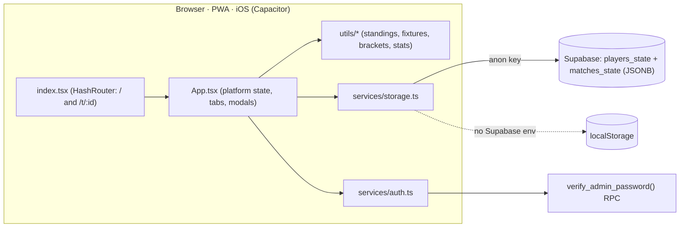

<p align="center"></p>

<p align="center">
  <a href="https://github.com/abhinav-adtechs/fifa-league-tracker/actions/workflows/ci.yml"></a>
  <a href="LICENSE"></a>
  
  <a href="https://fifa-league-tracker.vercel.app"></a>
  
  
  
</p>

<p align="center"><b>Run your office or friends' FIFA / EA SPORTS FC league like a real competition — fixtures, brackets, fair standings and the stats to argue about.</b></p>

<p align="center">
  <a href="#-features">Features</a> ·
  <a href="#-quick-start">Quick start</a> ·
  <a href="#-architecture">Architecture</a> ·
  <a href="#-docs">Docs</a> ·
  <a href="#-roadmap">Roadmap</a> ·
  <a href="#-contributing">Contributing</a>
</p>

## Why FIFA League Tracker?

Friend leagues fall apart over two things: nobody remembers the results, and the table is unfair to whoever has played fewer games. This app records every match, rebuilds all stats from match history, and offers a **normalised ranking** that regresses small samples — two lucky wins don't beat ten wins from fifteen. When the league grows into a proper event, the same app plans round-robins, group stages and knockout brackets for you.

It is a single-page React app that works as a website, an installable PWA and a native iOS app, with Supabase for shared state (or `localStorage` if you just want to try it).

## ✨ Features

<table>
<tr>
<td width="50%" valign="top">

### 🏆 Four tournament formats

**Open League** (no schedule — record games as they happen), **League** (round-robin, N meetings per pair), **Knockout** (bracket with byes and a 3rd-place playoff) and **League + Knockout** (groups, then the top qualifiers into a bracket).

</td>
<td width="50%" valign="top">

### 📊 Three ways to rank

**Normalised** (consistency-weighted with a goal-difference bonus), **Points per game**, or the classic **Table** — each with its own tie-breakers and a W/D/L form guide. The maths is in [`docs/RANKING.md`](docs/RANKING.md).

</td>
</tr>
<tr>
<td valign="top">

### 🔮 Promotion path

For every player, how many wins it takes to overtake the rank above — against anyone, or head-to-head against that rival — for both narrow and dominant wins.

</td>
<td valign="top">

### ⚔️ Head-to-head

Pick two players in Matches to see their record, goals, current streak and biggest wins and losses against each other.

</td>
</tr>
<tr>
<td valign="top">

### 👤 My Performance

A calendar histogram of match days, consistency, win rate, goals for and against, and your biggest win and loss — with the opponent's name.

</td>
<td valign="top">

### 📈 League stats

Total matches and goals, **Golden Boot** and **Best Defense**, plus points and normalised score over time.

</td>
</tr>
<tr>
<td valign="top">

### 🗓 Planning and progress

The create dialog previews how many league and knockout matches your format and player count produce. Running tournaments show a completion bar and games left.

</td>
<td valign="top">

### 🛠 Admin tools

A global admin creates tournaments; tournament admins record, edit and delete results, manage the squad (with team names), and set groups and seeding before the first match.

</td>
</tr>
<tr>
<td valign="top">

### 📱 Web, PWA and iOS

Install it from the browser with Add to Home Screen, or build the bundled Capacitor iOS app. Sessions use `localStorage` on the web and Capacitor Preferences on iOS.

</td>
<td valign="top">

### 🎨 Themes and deep links

Four themes — Dark, Light, Breeze and Amber — and shareable tournament links (`/#/t/<tournament-id>`).

</td>
</tr>
</table>

## 🧰 Tech stack

**App** &nbsp;


**Data & hosting** &nbsp;


**Mobile** &nbsp;


## 🏗 Architecture



All league logic runs in the browser. State is saved as two JSON documents — the player pool, and everything else (tournaments, fixtures, matches, tournament admins) — in Supabase or `localStorage`, and standings and stats are recomputed from the raw match list on every load. Details, data model and the security model are in [`docs/ARCHITECTURE.md`](docs/ARCHITECTURE.md).

## 🚀 Quick start

**Prerequisites:** Node.js 20.19+ or 22.12+ (required by `@vitejs/plugin-react` 5) and npm. For iOS: Xcode and CocoaPods.

```bash
git clone https://github.com/abhinav-adtechs/fifa-league-tracker.git
cd fifa-league-tracker
npm ci
cp .env.example .env.local   # optional: uncomment and fill in to use Supabase
npm run dev                  # http://localhost:3000
```

| Command            | What it does                                      |
| ------------------ | ------------------------------------------------- |
| `npm run dev`      | Vite dev server on port 3000 (bound to `0.0.0.0`) |
| `npm run build`    | Production build to `dist/`                       |
| `npm run preview`  | Serve the production build locally                |
| `npm run ios`      | Build, `npx cap sync ios`, and open Xcode         |
| `npm run cap:sync` | Copy the latest `dist/` into the iOS project      |

> [!TIP]
> To use shared storage, create the two state tables and the admin RPC in Supabase first — [`docs/DEPLOYMENT.md`](docs/DEPLOYMENT.md) has the SQL and the Vercel and iOS steps.

<details>
<summary><b>iOS app step by step</b></summary>

The same web app runs as a native iOS app via Capacitor (one codebase, one UI). Unlike a remote WebView, the iOS app bundles the built `dist/` folder.

1. `npm run build`
2. `npm run cap:sync`
3. Open `ios/App/App.xcworkspace` in Xcode, pick a simulator or device, configure signing, and run.

`npm run ios` does all three in one go.

</details>

## ⚙ Configuration

Variables are read by `vite.config.ts` at build time and inlined into the bundle, so use only the public anon key.

| Variable            | Required | Description                                                                |
| ------------------- | -------- | -------------------------------------------------------------------------- |
| `SUPABASE_URL`      | No       | Supabase project URL (`NEXT_PUBLIC_SUPABASE_URL` also accepted)            |
| `SUPABASE_ANON_KEY` | No       | Supabase anon (public) key (`NEXT_PUBLIC_SUPABASE_ANON_KEY` also accepted) |

When either is missing the app logs a warning and keeps all data in `localStorage`.

> [!NOTE]
> Branding — app name, header and footer text, the FC26 shield, PWA manifest and Capacitor app id — lives in `App.tsx`, `index.html`, `public/` and `capacitor.config.ts`.

## 📁 Project structure

```text
fifa-league-tracker/
├── index.html               # Theme CSS variables, Tailwind config, PWA meta tags
├── index.tsx                # HashRouter: "/" and "/t/:tournamentId"
├── App.tsx                  # Platform state, tournament workspace, tabs and modals
├── types.ts                 # Tournament, fixture, match and player types
├── components/
│   ├── Standings.tsx        # Normalised / PPG / Table views
│   ├── RankProjection.tsx   # Promotion path
│   ├── MatchList.tsx        # History, date groups, 30-day histogram, head-to-head
│   ├── MyPerformance.tsx    # Personal stats
│   ├── Dashboard.tsx        # League stats and charts
│   └── Tournament*.tsx, CreateTournamentModal.tsx
├── utils/
│   ├── standings.ts         # Stats from match history + ranking functions
│   ├── tournaments.ts       # Fixtures, groups, brackets, progress
│   ├── createTournamentPlan.ts
│   └── headToHead.ts, myPerformance.ts, leagueStats.ts, …
├── services/
│   ├── storage.ts           # Supabase JSONB rows or localStorage
│   ├── auth.ts              # Global and tournament admin auth
│   └── sessionStorage.ts    # localStorage (web) / Capacitor Preferences (iOS)
├── supabase_auth_setup.sql  # admin_passwords, audit table, verify_admin_password()
├── fix_function.sql         # Recreates verify_admin_password()
├── sql/                     # set_admin_password.sql: add an admin or change a password
├── public/                  # PWA manifest, icons, FC26 shield
└── ios/                     # Capacitor iOS project
```

## 📚 Docs

| Doc                                            | What's inside                                                      |
| ---------------------------------------------- | ------------------------------------------------------------------ |
| [`docs/ARCHITECTURE.md`](docs/ARCHITECTURE.md) | State model, data flow, tournament engine, auth and security model |
| [`docs/RANKING.md`](docs/RANKING.md)           | Normalised score, tie-breakers, promotion path and fixture maths   |
| [`docs/DEPLOYMENT.md`](docs/DEPLOYMENT.md)     | Supabase tables, admin setup, Vercel and iOS                       |
| [`CHANGELOG.md`](CHANGELOG.md)                 | Release history                                                    |

## 🗺 Roadmap

- [ ] Compile Tailwind at build time instead of loading the Play CDN
- [ ] Code-split `App.tsx` and lazy-load tournament views
- [ ] Unit tests for standings, fixtures and brackets
- [ ] Commit the Supabase schema for `players_state` and `matches_state`
- [ ] Move admin auth and writes behind Supabase Auth and RLS
- [ ] Store tournaments and matches in normalized tables
- [ ] Replace the hard-coded avatar map with uploads or generated avatars

## 🤝 Contributing

Issues and PRs are welcome — see [`CONTRIBUTING.md`](CONTRIBUTING.md) for setup, conventions and the PR checklist. Please follow the [Code of Conduct](https://github.com/abhinav-adtechs/.github/blob/main/CODE_OF_CONDUCT.md) and report vulnerabilities privately per the [security policy](https://github.com/abhinav-adtechs/.github/blob/main/SECURITY.md).

> [!NOTE]
> [superjoin-health-league](https://github.com/abhinav-adtechs/superjoin-health-league) — a workplace fitness league — was forked from this repository and shares its history up to 9 Feb 2026.

## 📄 License

[MIT](LICENSE) © 2026 Abhinav Das

## Star history

<a href="https://star-history.com/#abhinav-adtechs/fifa-league-tracker&Date"></a>

---

<p align="center">
  Built by <a href="https://github.com/abhinav-adtechs">Abhinav Das</a><br>
  <sub>If this project helped you, consider giving it a ⭐</sub>
</p>

<p align="center"><sub>FIFA and EA SPORTS FC are trademarks of their respective owners. This is an unofficial fan project and is not affiliated with, sponsored or endorsed by FIFA or Electronic Arts.</sub></p>
