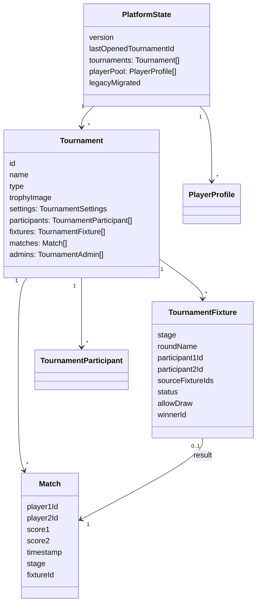
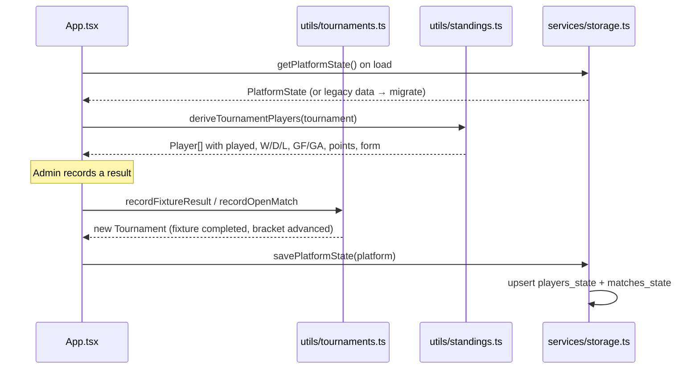

# Architecture

FIFA League Tracker is a client-only React 18 single-page app built with Vite. There is no custom backend: league logic runs in the browser and state is persisted as JSON in Supabase, or in `localStorage` when Supabase is not configured. The same build is served on the web, installed as a PWA, and bundled into a Capacitor iOS app.

## Contents

- [Module map](#module-map)
- [State model](#state-model)
- [Persistence](#persistence)
- [Data flow](#data-flow)
- [Tournament engine](#tournament-engine)
- [Authentication and roles](#authentication-and-roles)
- [Security model](#security-model)
- [Platforms](#platforms)
- [Repository history](#repository-history)

## Module map

| Path                                                        | Responsibility                                                                                                                                                       |
| ----------------------------------------------------------- | -------------------------------------------------------------------------------------------------------------------------------------------------------------------- |
| `index.tsx`                                                 | Mounts the app inside a `HashRouter` with two routes: `/` and `/t/:tournamentId`                                                                                     |
| `App.tsx`                                                   | Owns `PlatformState`; tournament switcher, workspace tabs (Table, Bracket, Matches, Performance, Stats, Squad, Settings), modals, theme switcher, global admin login |
| `components/Standings.tsx`                                  | Table with Normalised / PPG / Table views and form guide                                                                                                             |
| `components/RankProjection.tsx`                             | "Promotion Path" — wins needed to overtake the next rank                                                                                                             |
| `components/MatchList.tsx`                                  | History grouped by date, 30-day histogram, player and head-to-head filters                                                                                           |
| `components/MyPerformance.tsx`                              | Per-player calendar histogram and personal stats                                                                                                                     |
| `components/Dashboard.tsx`                                  | League-wide stats and trend charts (Recharts)                                                                                                                        |
| `components/TournamentBracket.tsx`                          | Knockout bracket view                                                                                                                                                |
| `components/TournamentSquad.tsx`                            | Participants and team names                                                                                                                                          |
| `components/TournamentAdminPanel.tsx`                       | Tournament settings, groups, seeding, admins, result editing                                                                                                         |
| `components/CreateTournamentModal.tsx`                      | Format, players, guests, trophy and settings, with a match-count preview                                                                                             |
| `utils/standings.ts`                                        | Rebuilds per-player stats from matches; ranking comparators                                                                                                          |
| `utils/tournaments.ts`                                      | Fixture generation, groups, knockout brackets, result recording, progress                                                                                            |
| `utils/createTournamentPlan.ts`                             | Match-count summary for the create dialog                                                                                                                            |
| `utils/headToHead.ts`, `myPerformance.ts`, `leagueStats.ts` | Derived statistics                                                                                                                                                   |
| `services/storage.ts`                                       | Read/write platform state (Supabase or `localStorage`)                                                                                                               |
| `services/auth.ts`                                          | Global admin and tournament admin verification                                                                                                                       |
| `services/sessionStorage.ts`                                | Session storage: `localStorage` on web, Capacitor Preferences on native                                                                                              |
| `index.html`                                                | Theme CSS variables, Tailwind config and component styles, PWA meta tags                                                                                             |

## State model

Everything the app knows lives in one `PlatformState` object (`types.ts`):

- **Player pool** — reusable player profiles shared across tournaments; each tournament copies them in as participants with an optional team name, group and seed.
- **Fixtures vs matches** — fixtures are the planned schedule; a match is a played result. Open leagues have no fixtures and only matches.
- **Derived data** — standings, form, head-to-head, performance and league stats are never stored; `computePlayersWithStats` rebuilds them from the match list.

## Persistence

`services/storage.ts` writes two rows, both with `id = 'default'`:

| Table           | Column           | Contents                                                                   |
| --------------- | ---------------- | -------------------------------------------------------------------------- |
| `players_state` | `players` (JSON) | `playerPool`                                                               |
| `matches_state` | `matches` (JSON) | The full `PlatformState` envelope (tournaments, fixtures, matches, admins) |

Every save upserts both rows. If `SUPABASE_URL` or `SUPABASE_ANON_KEY` is missing at build time, the same data goes to `localStorage` under `fifa_player_pool` and `fifa_platform_state`.

On first load after upgrading from the original single-league version (which stored plain `Player[]` and `Match[]` arrays in the same rows), `createPlatformFromLegacy` wraps the old data into one Open League tournament and sets `legacyMigrated`.

The SQL for the two state tables is not committed yet; [DEPLOYMENT.md](DEPLOYMENT.md) has a minimal definition.

## Data flow

State updates are immutable: each tournament helper returns a new `Tournament`, the app swaps it into `PlatformState`, re-renders, and saves.

## Tournament engine

All in `utils/tournaments.ts`:

| Format            | Fixtures                                                                                                           | Table                    | Bracket |
| ----------------- | ------------------------------------------------------------------------------------------------------------------ | ------------------------ | ------- |
| Open League       | none — `recordOpenMatch` appends results                                                                           | Normalised / PPG / Table | —       |
| League            | Round-robin (circle method), `matchesPerOpponent` cycles with home/away swapped each cycle                         | Table                    | —       |
| Knockout          | `createKnockoutFixtures` — padded to the next power of two with byes; 3rd-place playoff from the semi-final losers | —                        | ✓       |
| League + Knockout | Round-robin per group, then the top `qualifierCount` into a bracket                                                | Table per group          | ✓       |

- **Groups** — participants are assigned to groups A, B, C… (`assignGroupsToParticipants`); admins can reorder rosters and groups until the first match is played.
- **Qualification** — with several groups, qualifiers are taken position by position across groups (all group winners, then all runners-up, …); with one group, the top of the table.
- **Advancement** — knockout fixtures reference their source fixtures and an outcome (`WINNER` / `LOSER`); `advanceKnockoutFixtures` fills slots as results arrive and resolves byes. Knockout results cannot be draws.
- **Editing** — `editFixtureResult` and `deleteFixtureResult` rewind dependent knockout fixtures so the bracket stays consistent.

The maths behind the rankings and fixture counts is in [RANKING.md](RANKING.md).

## Authentication and roles

| Role             | Can                                                                       | How it is checked                                                                                                                                                                          |
| ---------------- | ------------------------------------------------------------------------- | ------------------------------------------------------------------------------------------------------------------------------------------------------------------------------------------ |
| Viewer           | See every tournament, table, bracket and stat                             | No login                                                                                                                                                                                   |
| Global admin     | Create tournaments                                                        | `verify_admin_password` RPC (bcrypt via `pgcrypto`, defined in `supabase_auth_setup.sql`), restricted to the admin named by `GLOBAL_ADMIN_NAME` in `services/auth.ts`; session cached for 24 h via `sessionStorage.ts` |
| Tournament admin | Record, edit and delete results; manage squad, groups, seeding and admins | Name + password checked against the SHA-256 hashes stored in that tournament's `admins`; the global admin and the legacy league's admins have no stored hash and go through `verify_admin_password` |

`supabase_auth_setup.sql` also creates an `admin_login_audit` table and an `admin_login_summary` view.

## Security model

This is a tool for a trusted group, and its protections are deliberately light:

- Admin checks gate the **UI**. Writes go straight from the browser to Supabase with the public anon key, so the tables must allow anonymous `select` and `upsert`, and anyone with the anon key can change the state.
- Tournament admin password hashes (unsalted SHA-256) are stored inside the shared JSON document that every client downloads.
- Saves replace whole documents, so two admins saving at the same moment can overwrite each other (last write wins).

Moving admin checks and writes behind Supabase Auth and RLS, and splitting the JSON into normalized tables, are on the [roadmap](../README.md#-roadmap).

## Platforms

- **Web** — static `dist/` from `vite build`, deployable to any static host (the reference deployment is on Vercel). Routing uses hash URLs, so no rewrite rules are needed.
- **PWA** — `public/manifest.webmanifest`, icons and Apple meta tags in `index.html` enable Add to Home Screen in standalone mode.
- **iOS** — Capacitor 6 with `webDir: "dist"`; the web build is bundled into the app. `@capacitor/preferences` stores the admin session natively.

Styling uses Tailwind via the Play CDN script in `index.html`, configured inline, plus hand-written CSS variables for the four themes.

## Repository history

The app was first scaffolded with Google AI Studio and grew into a single-league tracker with PWA support (5–19 Feb 2026), gained rank projections (March 2026), and became a full tournament platform with brackets and groups (April 2026). [superjoin-health-league](https://github.com/abhinav-adtechs/superjoin-health-league) was created from this repository's first nine commits. See [CHANGELOG.md](../CHANGELOG.md).
